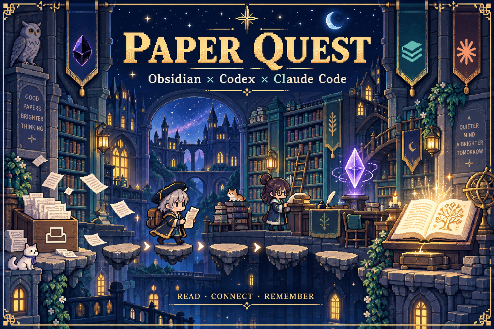

  

<h1 align="center">Obsidian · Codex · Claude Code for Academy</h1>

  <strong>把读过的论文，接进可以持续积累的知识库。</strong> 
  一份给 AI 读的规则文件，覆盖全文阅读、论文归档、方法索引与知识关联。

  <a href="llm-wiki-starter.md"><strong>阅读完整规则</strong></a>
  ·
  <a href="#quick-start">开始使用</a>
  ·
  <a href="#workflow">看看归档流程</a>
  ·
  <a href="#english">English</a>

---

## 这个仓库提供什么

核心文件只有 [`llm-wiki-starter.md`](llm-wiki-starter.md)。

把它交给能够读写本地文件的 AI Agent，让 Agent 按统一规则维护你的 Obsidian 学术知识库。你负责选论文、提问题、确认归档范围；Agent 负责阅读来源、整理页面、维护关联和检查文件。

规则来自持续使用中的学术归档实践，重点放在容易出错的细节：英文原题漏写、DOI 串到相邻文章、同一论文重复建页、SI 找不到入口、公式错位、概念链接失效，以及把推断写成论文结论。

README 和两张像素风插图用于介绍这套工作流。全部执行规则、论文模板和初始化说明都保存在同一份文件中。

## 让一篇论文留下什么

| 你希望以后找到 | 规则要求保留 |
|---|---|
| “这篇论文叫什么，谁写的？” | 中文译名、英文原题、完整作者、期刊或版本 |
| “它究竟证明了什么？” | 核心问题、研究设计、关键数据、条件与不确定性 |
| “这个结论能用到哪里？” | 测量对象、推断边界、适用范围与版本状态 |
| “我能回到原文核对吗？” | 精确的 PDF 路径、SI 列表、图表或页码出处 |
| “它和之前读的有什么关系？” | 有依据的论文关联、主题页和概念页 |
| “这个研究问题该用什么方法？” | 从问题出发的学术工具箱，包含检测对象与解释边界 |

## 开始使用

准备一个 Obsidian 文件夹，以及能够读取论文、编辑本地文件的 Codex、Claude Code 或其他 Agent。PDF 提取与图表查看能力由你的 Agent 环境提供。

**1. 获取规则**

打开 [llm-wiki-starter.md](llm-wiki-starter.md)，将文件保存到你的知识库根目录，保持原名。

**2. 让 AI 读取并初始化**

在该目录启动 Agent，发送：

~~~text
先完整读取 llm-wiki-starter.md。
我的研究方向是：[填写你的方向]。
请检查当前目录，给出知识库初始化方案和 purpose.md 草稿。
列出需要创建的文件与学科目录，等我确认后执行。
~~~

新会话也请明确要求 Agent 先读取这个文件。它的文件名本身不会保证被工具自动加载。已有 AGENTS.md 或 CLAUDE.md 的用户，可以在现有入口里指向它。

**3. 放入论文和 SI**

初始化完成后，把文件放进 `raw/inbox/`。主文与补充材料可以一起交给 Agent；后补 SI 时，规则要求更新对应论文页。

**4. 发起归档**

~~~text
归档 inbox，并更新学术工具箱。
请按 llm-wiki-starter.md 完整阅读、查重和比较版本，
给出文件去向及页面更新清单，确认后执行。
~~~

**5. 阅读、追问、积累**

在 Obsidian 中打开 `wiki/index.md`，查看论文页及其来源。继续提问：

~~~text
这些论文对同一问题的测量对象和结论有什么差别？
请区分作者发现、作者解释和跨论文推断，
列出支持每个判断的原始来源。
~~~

## 从 inbox 到知识库

  

| 阶段 | Agent 要完成的工作 |
|---|---|
| 01 · INBOX | 识别主文、SI、重复文件与不同版本 |
| 02 · READ | 阅读全文、图表及支撑结论所需的补充材料 |
| 03 · VERIFY | 五项查重、核对书目、比较版本、提交具体计划 |
| 04 · ARCHIVE | 按确认的去向归档，写入统一论文页 |
| 05 · CONNECT | 更新有证据支持的主题关联和学术工具箱 |
| 06 · REVIEW | 检查来源路径、字段、公式与链接，更新目录、总览和日志 |

重复文件、读取失败的文件，以及用户指定保留的文件，都需要在结果中说明去向。清空文件夹不能替代完整处理。

## 一份统一的论文页

每篇论文优先具备中文标题、英文原题、作者和期刊／版本。可核实的 DOI 放在英文原题之后；无法核实就省略该行。

~~~markdown
# 中文论文译名

**论文**：Exact English Original Title  
**作者**：完整作者列表，按原文顺序  
**期刊 / 版本**：已核实的期刊名称或预印本平台与版本  

## 核心问题
## 实验与判别方法
## 核心结果
## 关键解释边界
## 后续研究
## 关联
## Sources
~~~

综述使用“证据范围与综合方法”；理论和数学论文使用“模型、定义与证明结构”。只有形成有依据、可检验的预测时，才使用“可检验的新假说”。[完整模板与字段说明](llm-wiki-starter.md#canonical-paper-page)包含 YAML、双语别名、来源路径及 SI 索引。

## 这次更新补齐的规则

- **五项查重**：题名与作者、来源路径、作者年份前缀、文件哈希、DOI／持久标识符。
- **版本比较**：预印本与正式版分别核对方法、数据、结论和讨论，保留有价值的删改记录。
- **可追溯归档**：主文使用 `source_pdf`；补充材料统一使用列表字段 `source_supplement`。
- **证据边界**：保留关键数字与条件，区分发现、解释和推断；不强行制造缺陷或新假说。
- **有限的旧文献查找**：缺失标识符只做一次有界核查，不反复搜索，不猜 DOI。
- **完整性检查**：核对 YAML、固定章节、入站与出站链接、目录登记，并从实际文件重新计算页数。

## 学术工具箱怎样积累

归档发现新的方法、验证结果或解释边界时，更新 `wiki/topic-academic-methodology.md`。每行回答四件事：

| 研究问题 | 方法与直接检测对象 | 适用条件与解释边界 | 来源 |
|---|---|---|---|
| 想知道什么？ | 实际测到了什么？ | 需要什么假设，能推到哪一步？ | 对应论文页 |

同一方法的普通重复使用可以合并到已有条目。方法索引的价值来自可比较的信息和可回查的证据。

## 使用边界

执行效果取决于 Agent 的阅读能力、文件工具和你的复核。规则要求阅读全文及核对证据，关键结论仍应回到原文检查。

批量修改、新学科目录和文件移动按规则确认。已有知识库可以逐步采用这些约定；仅修复书目信息时，保持原有分析内容。

本仓库提供规则和展示素材。论文原文与个人笔记保存在你自己的知识库中。

## English

**A single-file guide for an AI-maintained academic wiki.**

Give [`llm-wiki-starter.md`](llm-wiki-starter.md) to a file-capable agent working in your Obsidian vault. It defines full-source reading, bilingual paper metadata, five duplicate checks, preprint comparisons, supplement tracking, evidence boundaries, method indexing, and completion checks.

Ask the agent to read the file explicitly at the start of a session. Agree on the initialization and batch plan, then place papers in `raw/inbox/`. All operating rules and templates remain in that one file.

## 来源与视觉

知识库组织方式参考 [Andrej Karpathy 的 LLM Wiki](https://gist.github.com/karpathy/442a6bf555914893e9891c11519de94f)，本项目补充面向学术论文的归档细则。

展示图采用 AI 生成的原创像素学者与奇幻图书馆场景，视觉方向受《克鲁赛德战记》启发。图中的 Paper Quest 是本次展示主题；项目名称保持 Obsidian-Codex-CC-for-academy。

发现规则冲突或有实际使用案例，欢迎在 [Issues](https://github.com/NoNightWatch/Obsidian-Codex-CC-for-academy/issues) 中反馈。
