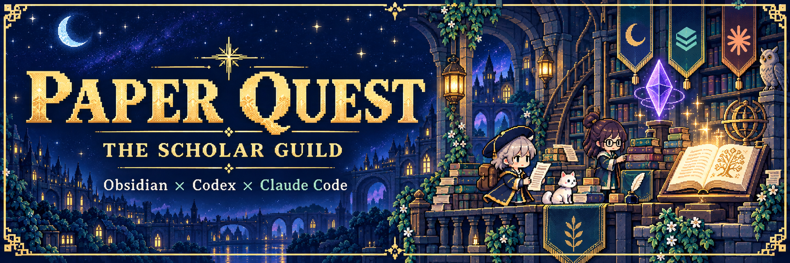
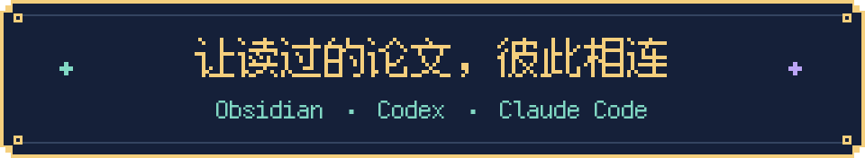
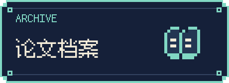
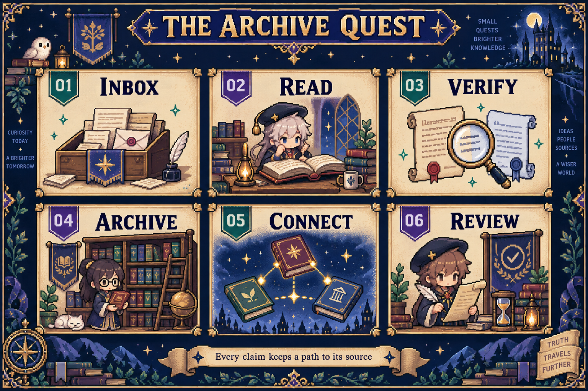
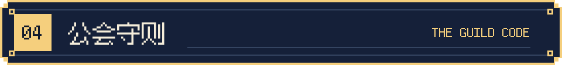
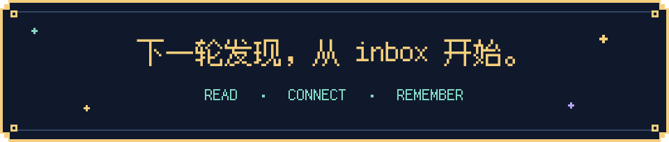

  

  

  <strong>给 AI 一份归档规则，给自己一座持续积累的学术知识库。</strong> 
  从 inbox 中的论文，到有来源、有方法、有联系的研究笔记。

  
  &nbsp;
  

  <a href="#workflow">探索归档地图</a> ·
  <a href="#guild-code">阅读公会守则</a> ·
  <a href="#faq">常见问题</a> ·
  <a href="README.en.md">English</a>

 

  

读到一篇有用的论文，留下摘要只是起点。下次做综述、比较方法或追问证据时，你还需要找回它的原文、关键条件，以及与其他研究的联系。

**这个仓库把这些要求写进一份给 AI 读的文件：[llm-wiki-starter.md](llm-wiki-starter.md)。** 让能够读写本地文件的 Agent 按规则维护知识库，在 Obsidian 中阅读、检索和追问。

<table>
<tr>
<td width="50%" valign="top">

<strong>找得到，也查得回。</strong>

中文译名、英文原题、作者、期刊与版本放在固定位置。主文和 SI 都有入口，关键数字能回到原始证据。

</td>
<td width="50%" valign="top">

<strong>读过的论文，开始彼此对话。</strong>

围绕共同问题汇聚主题，比较方法与解释边界。只有证据支持时，才建立概念关联和可检验的新假说。

</td>
</tr>
</table>

  <strong>1 份核心文件 · 5 项身份核对 · 8 条归档铁律</strong> 
  规则、论文模板、初始化说明，都在同一个 Markdown 文件里。

 

  

准备一个 Obsidian 文件夹，以及能够读取论文、编辑本地文件的 Codex、Claude Code 或其他 Agent。

### Ⅰ · 带上规则书

打开 [llm-wiki-starter.md](llm-wiki-starter.md)，将文件保存到知识库根目录，保持原名。

### Ⅱ · 建立你的研究公会

在该目录启动 Agent，发送下面这段话，把研究方向替换成自己的：

~~~text
先完整读取 llm-wiki-starter.md。
我的研究方向是：[填写你的方向]。
请检查当前目录，给出知识库初始化方案和 purpose.md 草稿。
列出需要创建的文件与学科目录，等我确认后执行。
~~~

### Ⅲ · 开始第一轮归档

初始化完成后，把论文和补充材料放进 `raw/inbox/`，再发送：

~~~text
归档 inbox，并更新学术工具箱。
请按 llm-wiki-starter.md 完整阅读、查重和比较版本，
给出文件去向及页面更新清单，确认后执行。
~~~

完成后，从 Obsidian 中的 `wiki/index.md` 开始阅读。

<strong>▸ 新会话与已有知识库怎么处理？</strong>

新会话请明确要求 Agent 先读取 `llm-wiki-starter.md`。文件名本身不会保证被工具自动加载。

已有 `AGENTS.md` 或 `CLAUDE.md` 的用户，可以在现有入口里指向它。已有知识库先检查当前结构，分批采用约定；规则更新不会自动授权全库重写。

 

  

**你负责选论文、提问题、确认范围。Agent 按六个阶段整理与核对。**

  

<strong>▸ 展开六个阶段的具体任务</strong>

| 阶段 | 应当完成的工作 |
|---|---|
| 01 · INBOX | 识别主文、SI、重复文件与不同版本 |
| 02 · READ | 阅读全文、图表及支撑结论所需的补充材料 |
| 03 · VERIFY | 五项查重、核对书目、比较版本、提交具体计划 |
| 04 · ARCHIVE | 按确认的去向归档，写入统一论文页 |
| 05 · CONNECT | 更新有依据的主题关联与学术工具箱 |
| 06 · REVIEW | 检查来源路径、字段、公式与链接，更新目录、总览和日志 |

重复文件、读取失败的文件，以及用户指定保留的文件，都需要说明处置情况。

### 归档之后，继续追问

~~~text
这些论文对同一问题的测量对象和结论有什么差别？
请区分作者发现、作者解释和跨论文推断，
列出支持每个判断的原始来源。
~~~

学术工具箱会逐步积累“研究问题 → 方法 → 检测对象 → 解释边界 → 来源”。需要比较方法时，可以从问题出发找到相应证据。

 

  

**页面可以有冒险感，证据需要有出处。**

| 守则 | 落到每次归档的要求 |
|---|---|
| **认清论文身份** | 题名与作者、来源路径、作者年份前缀、文件哈希、持久标识符，五项交叉核对 |
| **保留版本差异** | 比较预印本与正式版的方法、数据、结论和讨论，保留有价值的删改记录 |
| **让来源可回查** | 主文使用 `source_pdf`；SI 统一记录在 `source_supplement` 列表 |
| **把解释留在边界内** | 区分发现、解释和推断；保留关键数字与条件 |
| **接受信息缺失** | DOI 无法确认就省略，旧文献做一次有界核查 |
| **完成后逐项核对** | 检查固定字段、章节、YAML、公式、链接和目录；按实际文件重算页数 |

<strong>▸ 看一篇论文页会长什么样</strong>

每篇论文优先具备中文标题、英文原题、作者与期刊／版本。可核实的 DOI 放在英文原题之后；无法核实就省略该行。

~~~markdown
# 中文论文译名

**论文**：Exact English Original Title  
**作者**：完整作者列表，按原文顺序  
**期刊 / 版本**：已核实的期刊名称或预印本平台与版本  

## 核心问题
## 实验与判别方法
## 核心结果
## 关键解释边界
## 后续研究
## 关联
## Sources
~~~

综述使用“证据范围与综合方法”；理论和数学论文使用“模型、定义与证明结构”。有依据且可检验的预测，放进“可检验的新假说”。

[阅读完整模板与字段说明](llm-wiki-starter.md#canonical-paper-page)。

<strong>▸ 查看八条归档铁律</strong>

1. 批量移动和目录调整先给出具体计划。
2. 保留原始来源和已有知识，按授权范围归档。
3. 文件移动或改名时同步维护引用。
4. 涉及三个以上文件的批量修改先确认。
5. 论文页保留精确来源路径，SI 逐项登记。
6. 完成五项查重，比较版本，再决定如何更新。
7. 学术判断以原始研究为证据，表达保持准确。
8. 保持论文模板、证据密度与版本标记。

[完整规则及例外处理](llm-wiki-starter.md#fatal-rules)。

 

  

<strong>▸ 需要安装专门的 Obsidian 插件吗？</strong>

这份规则通过 Markdown 文件和 wikilinks 组织知识库，无需专用插件。论文读取、图表查看和文件编辑能力由你使用的 Agent 环境提供。

<strong>▸ AI 会自动把所有论文处理好吗？</strong>

执行效果取决于 Agent 的阅读能力、文件工具和你的复核。规则要求阅读全文及核对证据，重要判断仍应回到原文检查。它不会自行启动后台任务。

<strong>▸ 能否只补标题、作者和期刊？</strong>

可以。规则区分完整归档与书目修复。只补检索信息时，保留原有分析，控制查找范围。

<strong>▸ 论文和个人笔记会被上传吗？</strong>

本仓库提供规则与展示素材。按本文件的归档流程，论文和个人笔记保存在你自己的知识库；上传 GitHub 或其他外部服务需要另外安排。

 

  

  <a href="llm-wiki-starter.md"><strong>领取规则书</strong></a>
  · <a href="https://github.com/NoNightWatch/Obsidian-Codex-CC-for-academy/issues">提交问题与使用反馈</a>
  · <a href="#quick-start">回到开始</a> 
  如果这套规则对你有用，欢迎 Star，或分享你的实际归档经验。

[**English · Read the complete guide**](README.en.md) · 完整英文版包含使用步骤、六阶段归档流程、论文模板、公会守则与常见问题。

<strong>Credits · 来源与视觉</strong>

知识库组织方式参考 [Andrej Karpathy 的 LLM Wiki](https://gist.github.com/karpathy/442a6bf555914893e9891c11519de94f)，本项目补充面向学术论文的归档细则。

